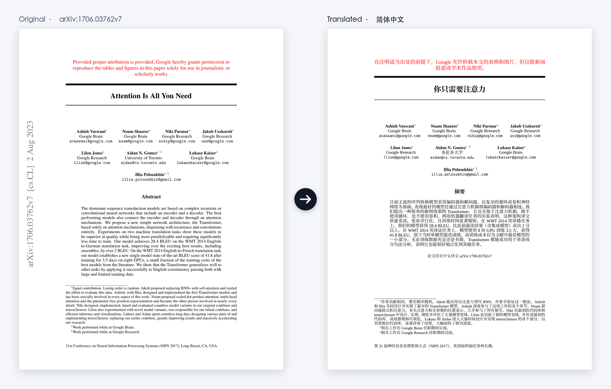

# Paper to Chinese

本仓库面向 Dot、Grok Bot、Muse 这些 personal agent 个人助手，利用他们的云电脑原汁原味的翻译 ArXiv 学术论文。

<p align="center">
  
</p>

## 背景

读中文的时候，我们的眼睛是"扫"的：一眼下去好几行，重点自己就跳出来了。

读英文论文就不行了。眼睛得一个词一个词地挪，读完一段，脑子里还要再翻译一遍。想快，只能靠翻译。

可现有的翻译工具，要么机翻味很重，读着比原文还累；要么把排版搅得一团糟：公式散架，图表错位，双栏变单栏。

所以：**不翻 PDF，直接翻 LaTeX 源码。**

> [!TIP]
> **不懂 LaTeX 没关系，不用在自己电脑上装任何东西。**
> 把这个项目和论文链接丢给你的 AI 助手，下载、翻译、编译都在它的云电脑里完成，你只需要等它把 PDF 发回来。

## 安装

把这个仓库的链接发给你的助手（Dot、Grok Bot、Muse 都行），说：

```text
帮我安装这个 skill：https://github.com/Lum1104/paper-to-chinese
```

装好后，直接把论文链接丢给它：

```text
把这篇论文翻成中文 PDF：https://arxiv.org/abs/1706.03762
```

<sub>首次使用会在云电脑里自动装最小 TeX 环境，多等 1~2 分钟，之后复用。</sub>
